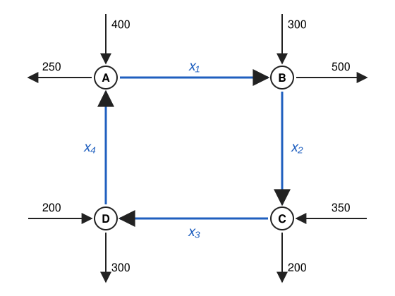
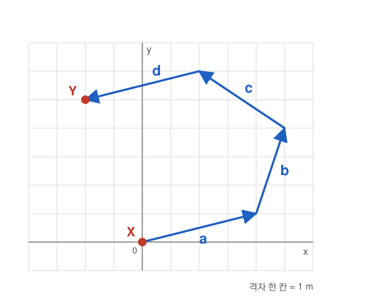
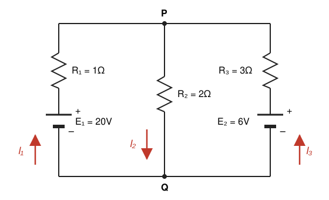

# 선형대수학 퀴즈 1

- 범위: 1.1, 1.2, 2.1, 2.2, 2.3, 3.1, 3.2, 3.3, 3.4, 4.1, 4.2, 5.1, 5.2
- 문제 유형: 전 문항 주관식 (챕터 순서 무작위)
- 난이도: 어려움
- 표기는 교재를 따른다: $\text{Det}(A) = |A|$, $\text{Adj}(A)$ (수반행렬), $\text{tr}(A)$ (대각합), $\text{rank}(A)$ (계수)
- 특별한 말이 없으면 모든 행렬과 벡터의 성분은 실수이다.
- VS Code 미리보기(`Cmd+Shift+V`)로 보면서 풀 것

---

### Q1.
실수 $a$에 대하여 다음 행렬의 계수(rank)를 $a$의 값에 따라 모두 구하시오.

$$
A = \begin{bmatrix} 1 & 1 & a \\ 1 & a & 1 \\ a & 1 & 1 \end{bmatrix}
$$

### Q2.
$\mathbf{u} = (4, -1, 2)$, $\mathbf{v} = (1, 1, -2)$ 이고 $\mathbf{w} = \mathbf{u} - 2\mathbf{v}$ 이다.

- (1) $\|\mathbf{w}\|$ 를 구하시오.
- (2) $\mathbf{w}$와 같은 방향의 단위벡터를 구하시오.
- (3) $\mathbf{w}$와 **반대 방향**이고 크기가 14인 벡터를 구하시오.
- (4) $\|\alpha\mathbf{w}\| = 21$ 을 만족하는 스칼라 $\alpha$를 모두 구하시오.

### Q3.
다음 선형시스템이 (i) 해가 없을 때, (ii) 유일한 해를 가질 때, (iii) 무한히 많은 해를 가질 때의 $a$ 값을 각각 구하시오. 또 (iii)의 경우 해집합을 매개변수로 나타내시오.

$$
\begin{cases}
x + 2y - 3z = 4 \\
3x - y + 5z = 2 \\
4x + y + (a^2 - 14)z = a + 2
\end{cases}
$$

### Q4.
다음 행렬 $N$에 대하여 물음에 답하시오.

$$
N = \begin{bmatrix} 0 & 2 & -1 \\ 0 & 0 & 3 \\ 0 & 0 & 0 \end{bmatrix}
$$

- (1) $N^2$, $N^3$ 을 구하시오.
- (2) $(I - N)(I + N + N^2) = I$ 임을 보이시오. (계산 없이 $N^3$의 값만으로 설명할 것)
- (3) $(I - N)^{-1}$ 을 구하시오.
- (4) 같은 방법으로 $(I + N)^{-1}$ 을 구하시오.

### Q5.
다음 각 방정식이 변수 $x, y, z$ (또는 $x_1, x_2$)에 관한 **선형방정식**인지 판정하시오. 선형이 아니면 그 이유를 쓰시오.

- (a) $\sqrt{3}\,x - \pi y + e^2 z = \ln 7$
- (b) $x^{-1} + 2y = 5$
- (c) $\sin\left(\dfrac{\pi}{4}\right)x_1 + 2^3 x_2 = \sqrt[3]{5}$
- (d) $2^x + y = 3$
- (e) $(x + y)^2 - (x - y)^2 = 8$
- (f) $(x + 1)^2 - x^2 = y$

### Q6.
$\begin{vmatrix} a & b & c \\ d & e & f \\ g & h & i \end{vmatrix} = 5$ 일 때 다음 행렬식의 값을 구하시오. 각 단계에서 사용한 행렬식의 성질을 밝힐 것.

$$
\text{(1)}\ \begin{vmatrix} a + 2g & b + 2h & c + 2i \\ 3d & 3e & 3f \\ g - a & h - b & i - c \end{vmatrix}
\qquad
\text{(2)}\ \begin{vmatrix} d & e & f \\ g & h & i \\ a & b & c \end{vmatrix}
$$

$$
\text{(3)}\ \begin{vmatrix} -2a & -2b & -2c \\ d + g & e + h & f + i \\ g & h & i \end{vmatrix}
\qquad
\text{(4)}\ \begin{vmatrix} a & 2b & c - a \\ d & 2e & f - d \\ g & 2h & i - g \end{vmatrix}
$$

### Q7.
다음 그림은 일방통행 도로망이다. 숫자는 시간당 차량 대수이고, $x_1, x_2, x_3, x_4$는 교차로 사이 도로의 교통량이다.

- (1) 각 교차로 A, B, C, D에서 성립하는 방정식을 세우시오.
- (2) 첨가행렬을 기약 행 사다리꼴로 만들어 일반해를 $x_4$에 대한 식으로 나타내시오.
- (3) 모든 도로의 교통량은 음수가 될 수 없다. $x_4$의 최솟값과 그때의 $x_1, x_2, x_3$을 구하시오.
- (4) 모든 도로의 교통량이 0 이상 400 이하가 되도록 하는 $x_4$의 범위를 구하시오.

### Q8.
$A = \begin{bmatrix} a & b \\ c & d \end{bmatrix} \neq O$ 이고 $A^2 = O$ 이다.

- (1) $A^2$을 직접 계산하여 $a + d = 0$ 이고 $ad - bc = 0$ 임을 보이시오. (힌트: $a + d \neq 0$ 이라고 가정하면 모순이 생김을 보일 것)
- (2) $a_{11} = 2$, $a_{12} = 4$ 일 때 $A$를 구하시오.
- (3) 이 결과를 이용하여 "행렬에서는 $AB = O$ 라도 $A = O$ 또는 $B = O$ 라고 할 수 없다"는 사실을 설명하시오.

### Q9.
교재는 벡터 $\mathbf{u} = (a, b)$의 방향을 $x$축의 양의 방향에서 시계 반대 방향으로 잰 각 $\theta$ ($0 \le \theta < 2\pi$)로 정의하고, $a \neq 0$ 이면 $\tan\theta = \dfrac{b}{a}$ 라고 한다. 다음 벡터의 방향 $\theta$를 구하시오.

- (1) $(-\sqrt{3}, 1)$
- (2) $(-1, -1)$
- (3) $(0, -2)$
- (4) (2)에서 $\tan\theta = 1$ 만으로 $\theta = \dfrac{\pi}{4}$ 라고 답하면 왜 틀리는지 설명하시오.

### Q10.
다음 행렬 $A$에 대하여 물음에 답하시오.

$$
A = \begin{bmatrix} 2 & 1 & 1 \\ 4 & 3 & 3 \\ 8 & 7 & 9 \end{bmatrix}
$$

- (1) 가우스 소거법으로 $U$를 구하고, 사용한 연산으로부터 $L$을 구하여 $A = LU$ 로 분해하시오. ($L$의 대각성분은 모두 1)
- (2) LU-분해법(전진대입 → 역대입)으로 $A\mathbf{x} = \mathbf{b}$, $\mathbf{b} = (1, 5, 15)^T$ 를 푸시오. 중간 벡터 $\mathbf{y}$도 쓸 것.
- (3) $L$과 $U$만 이용하여 $\text{Det}(A)$를 구하시오.

### Q11.
- (1) 다음 행렬식을 인수분해된 형태로 나타내시오.

$$
\begin{vmatrix} 1 & a & a^2 \\ 1 & b & b^2 \\ 1 & c & c^2 \end{vmatrix}
$$

- (2) (1)의 결과를 $4 \times 4$로 확장하여 다음 행렬식의 값을 구하시오.

$$
\begin{vmatrix} 1 & 1 & 1 & 1 \\ 1 & 2 & 4 & 8 \\ 1 & 3 & 9 & 27 \\ 1 & 4 & 16 & 64 \end{vmatrix}
$$

- (3) $\begin{vmatrix} 1 & 1 & 1 \\ 1 & 2 & x \\ 1 & 4 & x^2 \end{vmatrix} = 0$ 을 만족하는 $x$를 모두 구하시오.

### Q12.
다음 행렬 $A$에 대하여 물음에 답하시오.

$$
A = \begin{bmatrix} 1 & 4 & -2 \\ 0 & 3 & 5 \\ 6 & -1 & 2 \end{bmatrix}
$$

- (1) $A = S + K$ ($S$는 대칭행렬, $K$는 교대행렬)로 나타내시오.
- (2) 임의의 정방행렬을 이렇게 나타내는 방법은 **유일**함을 증명하시오.
- (3) 교대행렬의 주대각선 성분이 반드시 0인 이유를 설명하시오.

### Q13.
네 점 $(-1, 3)$, $(0, 1)$, $(1, 1)$, $(2, 9)$를 모두 지나는 3차 다항식 $p(x) = a_0 + a_1x + a_2x^2 + a_3x^3$ 이 있다.

- (1) $a_0, a_1, a_2, a_3$에 관한 선형시스템을 세우시오.
- (2) 소거법으로 풀어 $p(x)$를 구하고, $p(3)$을 구하시오.

### Q14.
알파벳을 A = 1, B = 2, ..., Z = 26 으로 바꾼 뒤, 2글자씩 묶어 $2 \times 1$ 열벡터를 만들고 왼쪽에 행렬 $A = \begin{bmatrix} 3 & 1 \\ 5 & 2 \end{bmatrix}$ 를 곱해 암호화하였다. 수신한 암호는 다음과 같다.

$$
57,\ 98,\ 81,\ 140,\ 79,\ 138
$$

- (1) $A^{-1}$을 구하시오.
- (2) 원래 메시지(영문 6글자)를 구하시오.
- (3) 키 행렬의 행렬식이 $\pm 1$ 이면 해독할 때 어떤 장점이 있는지, 행렬식이 2인 정수 행렬을 키로 쓰면 어떤 문제가 생길 수 있는지 설명하시오.

### Q15.
$A = \begin{bmatrix} 2 & 1 & 3 \\ 1 & 0 & 2 \\ 4 & 1 & 1 \end{bmatrix}$ 이다. 역행렬 전체를 구하지 말고 **여인수만** 이용하여 다음을 구하시오.

- (1) $\text{Det}(A)$
- (2) $A^{-1}$의 $(3, 1)$ 성분
- (3) $A^{-1}$의 $(1, 2)$ 성분
- (4) $A^{-1}$의 $(2, 3)$ 성분

### Q16.
$2 \times 3$ 행렬의 기약 행 사다리꼴(피벗은 모두 1)이 될 수 있는 형태를 **모두** 나열하시오. 임의의 수가 올 수 있는 자리는 $*$ 로 표시하고, 각 형태의 rank도 쓰시오. (영행렬 포함)

### Q17.
$\mathbf{u} = (1, 2, 3)$, $\mathbf{v} = (1, 0, -1)$ 이다.

- (1) $\|\mathbf{u} + t\mathbf{v}\|^2$ 을 $t$에 대한 식으로 나타내시오.
- (2) $\|\mathbf{u} + t\mathbf{v}\|$ 를 최소로 하는 실수 $t$와 그 최솟값을 구하시오.
- (3) 그때의 벡터 $\mathbf{u} + t\mathbf{v}$ 를 구하시오.

### Q18.
다음 선형시스템에 대하여 물음에 답하시오.

$$
\begin{cases}
x + y + z = 1 \\
x + 2y + az = 3 \\
x + 4y + a^2z = 9
\end{cases}
$$

- (1) 계수행렬의 행렬식을 $a$에 대한 인수분해된 식으로 구하시오.
- (2) 크래머의 규칙을 쓸 수 없는 $a$의 값을 모두 구하시오.
- (3) 크래머의 규칙으로 $z$를 $a$에 대한 식으로 구하시오.
- (4) (2)에서 구한 각 $a$에 대해, 시스템이 해가 없는지 무한히 많은 해를 가지는지 판정하시오.

### Q19.
$n \times n$ 행렬 $A, B$에 대하여 $AB - BA = I_n$ 을 만족하는 $A, B$는 존재하지 않음을 증명하시오.

### Q20.
세 지역 1, 2, 3 사이의 인구 이동을 나타내는 추이행렬 $P$가 다음과 같다. $p_{ij}$는 한 해 동안 지역 $j$에서 지역 $i$로 이동할 확률이다.

$$
P = \begin{bmatrix} 0.5 & 0.2 & 0.3 \\ 0.3 & 0.8 & 0.3 \\ 0.2 & 0 & 0.4 \end{bmatrix}
$$

- (1) $P$가 추이행렬이 될 수 있는 이유를 열의 관점에서 설명하시오.
- (2) 처음에 모든 인구가 지역 1에 있을 때, 즉 $\mathbf{x}(0) = (1, 0, 0)^T$ 일 때 $\mathbf{x}(1)$, $\mathbf{x}(2)$를 구하시오.
- (3) $P\mathbf{x} = \mathbf{x}$ 이고 성분의 합이 1인 벡터 $\mathbf{x}$(정상상태 벡터)를 구하시오. ($(P - I)\mathbf{x} = \mathbf{0}$ 을 가우스-조단 소거법으로 풀 것)

### Q21.
다음 선형시스템이 해를 가지기 위한 $a, b, c$ 사이의 조건을 구하시오.

$$
\begin{cases}
x - 2y + 3z = a \\
2x - 3y + 8z = b \\
4x - 7y + 14z = c
\end{cases}
$$

또 $a = 1$, $b = 2$ 이고 위 조건을 만족할 때 해집합을 매개변수로 나타내고, 기하학적으로 어떤 도형인지 쓰시오.

### Q22.
$D_n$을 주대각선 성분이 모두 2, 주대각선 바로 위와 바로 아래 성분이 모두 $-1$, 나머지가 모두 0인 $n \times n$ 행렬의 행렬식이라 하자.

$$
D_4 = \begin{vmatrix} 2 & -1 & 0 & 0 \\ -1 & 2 & -1 & 0 \\ 0 & -1 & 2 & -1 \\ 0 & 0 & -1 & 2 \end{vmatrix}
$$

- (1) $D_1, D_2, D_3$을 구하시오.
- (2) 제1행에 대한 여인수 전개를 이용하여 $D_n = 2D_{n-1} - D_{n-2}$ ($n \ge 3$) 임을 보이시오.
- (3) $D_n$을 $n$에 대한 식으로 구하시오.

### Q23.
로봇이 점 X에서 출발하여 벡터 $\mathbf{a}, \mathbf{b}, \mathbf{c}, \mathbf{d}$를 따라 차례로 움직여 점 Y에 도착했다.

- (1) 그림에서 $\mathbf{a}, \mathbf{b}, \mathbf{c}, \mathbf{d}$의 성분을 읽으시오.
- (2) X에서 Y로 가는 하나의 벡터 $\mathbf{p}$와 두 점 사이의 거리를 구하시오.
- (3) Y에서 X를 향하는 단위벡터를 구하시오.
- (4) 로봇이 Y에서 점 Z$(3, 3)$으로 가려고 한다. 이 로봇은 $\mathbf{p}_1 = (1, 1)$, $\mathbf{p}_2 = (1, -1)$ 방향으로만 움직일 수 있다. $\overrightarrow{\text{YZ}} = \alpha\mathbf{p}_1 + \beta\mathbf{p}_2$ 를 만족하는 $\alpha, \beta$를 구하시오.

### Q24.
$A = \begin{bmatrix} 2 & 4 \\ 1 & 3 \end{bmatrix}$ 이다.

- (1) $A$를 $I_2$로 바꾸는 기본 행 연산을 차례로 쓰고, 각 연산에 대응하는 기본행렬 $E_1, E_2, \dots$를 쓰시오.
- (2) 각 기본행렬의 역행렬을 구하고, $A$를 기본행렬들의 곱으로 나타내시오.
- (3) (1)의 결과를 이용하여 $A^{-1}$을 기본행렬들의 곱으로 나타내고 계산하시오.

### Q25.
다음 화학반응식의 계수 $x_1, \dots, x_6$을 가장 작은 양의 정수로 구하시오. 원소 K, Mn, O, H, Cl 각각에 대한 방정식을 세우고 첨가행렬로 풀 것.

$$
x_1\,\text{KMnO}_4 + x_2\,\text{HCl} \rightarrow x_3\,\text{KCl} + x_4\,\text{MnCl}_2 + x_5\,\text{H}_2\text{O} + x_6\,\text{Cl}_2
$$

### Q26.
$A, B$는 $3 \times 3$ 행렬이고 $\text{Det}(A) = -2$, $\text{Det}(B) = 3$ 이다. 다음 값을 구하시오.

- (1) $\text{Det}(2A^{-1})$
- (2) $\text{Det}(A^T B^2 A^{-1})$
- (3) $\text{Det}\big((2A)^{-1} B^T\big)$
- (4) $\text{Det}\big(\text{Adj}(A)\big)$ (힌트: $A \cdot \text{Adj}(A) = \text{Det}(A) I$)
- (5) $\text{Det}\big(\text{Adj}(\text{Adj}(A))\big)$

### Q27.
$A = \begin{bmatrix} 1 & 1 & 0 \\ 0 & 1 & 1 \\ 0 & 0 & 1 \end{bmatrix}$ 이다.

- (1) $A^2$, $A^3$을 구하시오.
- (2) $A^n$을 $n$에 대한 식으로 추측하고, 수학적 귀납법으로 증명하시오.
- (3) $A^{20}$의 $(1, 3)$ 성분을 구하시오.

### Q28.
세 벡터 $\mathbf{u} = (1, 2, t)$, $\mathbf{v} = (0, 1, 1)$, $\mathbf{w} = (t, 1, 2)$ 로 만들어지는 평행육면체를 생각하자.

- (1) 평행육면체의 체적을 $t$에 대한 식으로 나타내시오.
- (2) 세 벡터가 한 평면 위에 놓이는(체적이 0인) $t$를 모두 구하시오.
- (3) 체적이 6이 되는 $t$를 모두 구하시오.
- (4) $0 \le t \le 3$ 에서 체적의 최댓값과 그때의 $t$를 모두 구하시오.

### Q29.
다음 세 평면의 교집합을 구하시오.

$$
\begin{cases}
x + 2y - z = 3 \\
2x + 5y + z = 7 \\
x + 3y + 2z = 4
\end{cases}
$$

- (1) 해집합을 매개변수 $t$로 나타내시오.
- (2) 세 평면의 교집합은 기하학적으로 어떤 도형인가? 그 도형의 방향을 나타내는 벡터를 하나 쓰시오.
- (3) 해 중에서 $x = y$ 인 해를 구하시오.
- (4) 셋째 식의 상수항 4를 다른 값으로 바꾸면 해가 어떻게 되는지 설명하시오.

### Q30.
$X$를 $x$축 대칭(반사) 변환의 행렬, $R$을 원점을 중심으로 **시계 반대 방향** $90°$ 회전 변환의 행렬이라 하자.

- (1) $X$와 $R$을 구하시오.
- (2) "먼저 $x$축 대칭, 그다음 회전"을 하는 변환의 행렬과 "먼저 회전, 그다음 $x$축 대칭"을 하는 변환의 행렬을 각각 구하시오. (곱하는 순서에 주의)
- (3) (2)의 두 행렬은 각각 어떤 하나의 변환과 같은지 쓰고, 점 $(2, 1)$이 각각 어디로 옮겨지는지 구하시오.
- (4) 교재 예제 4-13의 회전 행렬 $\begin{bmatrix} \cos\theta & \sin\theta \\ -\sin\theta & \cos\theta \end{bmatrix}$ 에 $\theta = 90°$ 를 넣고 점 $(1, 0)$을 옮겨 보시오. 이 행렬은 어느 방향 회전인가?

### Q31.
다음을 증명하시오.

- (1) $n$이 홀수이면 $n \times n$ 교대행렬 $A$의 행렬식은 0이다.
- (2) $A^TA = I$ 를 만족하는 정방행렬 $A$의 행렬식은 $1$ 또는 $-1$이다.
- (3) (1)에서 "$n$이 홀수"라는 조건이 꼭 필요함을 $2 \times 2$ 반례로 보이시오.

### Q32.
다음 행렬 $M$에 대하여 물음에 답하시오.

$$
M = \begin{bmatrix} 1 & 2 & -1 & 3 & 4 \\ 2 & 4 & 0 & 2 & 6 \\ -1 & -2 & 3 & -7 & -5 \end{bmatrix}
$$

- (1) $M$의 기약 행 사다리꼴을 구하시오. 각 단계의 기본 행 연산을 교재 표기($(-2) \times R_1 + R_2 \to R_2$ 등)로 쓸 것.
- (2) $\text{rank}(M)$과 피벗이 있는 열을 쓰시오.
- (3) $M$이 변수 $x_1, x_2, x_3, x_4$에 관한 선형시스템의 첨가행렬이라면 이 시스템의 해는 어떠한가? 이유를 쓰시오.

### Q33.
세 점 $A(1, -2, 3)$, $B(4, 0, 1)$, $C(2, 5, -1)$이 있다.

- (1) 사각형 $ABCD$가 (꼭짓점이 이 순서대로 놓인) 평행사변형이 되도록 하는 점 $D$를 벡터를 이용하여 구하시오.
- (2) 꼭짓점의 순서를 정하지 않으면, 세 점 $A, B, C$와 함께 평행사변형을 이루는 넷째 꼭짓점은 모두 몇 개이며 각각 무엇인가?
- (3) 선분 $AB$를 $2 : 1$로 내분하는 점을 벡터의 합과 스칼라 곱으로 구하시오.

### Q34.
$A = \begin{bmatrix} 1 & 0 & 2 \\ 2 & -1 & 3 \\ 4 & 1 & 8 \end{bmatrix}$ 이다.

- (1) 첨가행렬 $[A \mid I]$에 가우스-조단 방법을 적용하여 $A^{-1}$을 구하시오. 각 단계의 행 연산을 쓸 것.
- (2) (1)의 결과를 이용하여 $A\mathbf{x} = (1, 0, 2)^T$ 를 푸시오.
- (3) $A^{-1}$의 성분이 모두 정수가 된 이유를 $\text{Det}(A)$와 수반행렬로 설명하시오.

### Q35.
다음 선형시스템에 대하여 물음에 답하시오.

$$
\begin{cases}
x_1 + 3x_2 - 2x_3 + 2x_5 = 0 \\
2x_1 + 6x_2 - 5x_3 - 2x_4 + 4x_5 - 3x_6 = -1 \\
5x_3 + 10x_4 + 15x_6 = 5 \\
2x_1 + 6x_2 + 8x_4 + 4x_5 + 18x_6 = 6
\end{cases}
$$

- (1) 첨가행렬의 기약 행 사다리꼴을 구하시오.
- (2) 피벗 변수와 자유변수를 구분하시오.
- (3) 일반해를 $\mathbf{x} = \mathbf{x}_p + r\mathbf{v}_1 + s\mathbf{v}_2 + t\mathbf{v}_3$ 꼴의 벡터 형태로 나타내시오.
- (4) $\mathbf{v}_1, \mathbf{v}_2, \mathbf{v}_3$은 어떤 시스템의 해인지 쓰고 그 이유를 설명하시오.

### Q36.
$A = \begin{bmatrix} 1 & 2 \\ 0 & 1 \end{bmatrix}$ 이다.

- (1) $AX = XA$ 를 만족하는 $2 \times 2$ 행렬 $X$를 모두 구하시오.
- (2) (1)의 $X$ 중에서 $X^2 = I$ 를 만족하는 것을 모두 구하시오.

### Q37.
다음 행렬식을 계산이 가장 적게 드는 행(또는 열)을 골라 여인수 전개로 구하시오. 왜 그 행(열)을 골랐는지도 쓰시오.

$$
\begin{vmatrix} 2 & 0 & 1 & 3 \\ 1 & 0 & -2 & 4 \\ 3 & 5 & 1 & -1 \\ 0 & 0 & 2 & 1 \end{vmatrix}
$$

### Q38.
다음 회로에서 전류 $I_1, I_2, I_3$를 구하려고 한다. 화살표는 전류의 방향을 **가정**한 것이고, 두 전지 모두 위쪽이 $+$극이다.

- (1) 마디 P에 키르히호프의 전류법칙을 적용한 식을 쓰시오.
- (2) 왼쪽 닫힌 회로(E₁, R₁, R₂)와 오른쪽 닫힌 회로(E₂, R₃, R₂)에 키르히호프의 전압법칙을 적용한 식을 쓰시오.
- (3) 세 식을 첨가행렬로 나타내어 $I_1, I_2, I_3$를 구하시오.
- (4) 음수로 나온 전류가 있다면 그 물리적 의미를 쓰시오.

### Q39.
선형시스템 $A\mathbf{x} = \mathbf{b}$ 가 서로 다른 두 해 $\mathbf{x}_1, \mathbf{x}_2$ 를 가진다고 하자.

- (1) 임의의 실수 $t$에 대해 $(1 - t)\mathbf{x}_1 + t\mathbf{x}_2$ 도 해임을 보이시오.
- (2) (1)을 이용하여 선형시스템의 해의 개수가 "정확히 2개"일 수 없는 이유를 설명하시오.
- (3) $\mathbf{x}_1 - \mathbf{x}_2$ 는 어떤 시스템의 해인가? 그 해는 자명해인가 비자명해인가?

### Q40.
$A = \begin{bmatrix} k & 1 & 0 \\ 1 & k & 1 \\ 0 & 1 & k \end{bmatrix}$ 이다.

- (1) $A$가 역행렬을 가지지 않는 $k$의 값을 모두 구하시오.
- (2) $k = 1$ 일 때 여인수 행렬과 수반행렬 $\text{Adj}(A)$를 구하시오.
- (3) $k = 1$ 일 때 $A^{-1} = \dfrac{1}{\text{Det}(A)}\text{Adj}(A)$ 로 역행렬을 구하고, $AA^{-1} = I$ 로 검산하시오.

### Q41.
- (1) $(i, j)$ 성분이 $a_{ij} = i + j$ 인 $5 \times 5$ 행렬 $A$의 rank를 구하시오. 행 사다리꼴을 이용해 근거를 쓸 것.
- (2) $(i, j)$ 성분이 $b_{ij} = ij$ 인 $5 \times 5$ 행렬 $B$의 rank를 구하시오.
- (3) (1), (2)의 결과로부터 $\text{Det}(A)$, $\text{Det}(B)$의 값을 말하시오.

### Q42.
세 점 $(5, 3)$, $(-2, 2)$, $(6, -4)$를 지나는 원의 방정식을 $x^2 + y^2 + Dx + Ey + F = 0$ 이라 하자.

- (1) $D, E, F$에 관한 선형시스템을 세우시오.
- (2) 시스템을 풀어 원의 방정식을 구하고, 원의 중심과 반지름을 구하시오.

### Q43.
$\mathbf{u}_1 = (1, 2, -1)$, $\mathbf{u}_2 = (2, 1, 3)$ 이다.

- (1) $\mathbf{w} = (k, 7, 0)$ 이 $\mathbf{u}_1, \mathbf{u}_2$의 선형결합 $a\mathbf{u}_1 + b\mathbf{u}_2$ 로 나타내어지도록 하는 $k$와 그때의 $a, b$를 구하시오.
- (2) $\mathbf{e}_1 = (1, 0, 0)$ 은 $\mathbf{u}_1, \mathbf{u}_2$의 선형결합으로 나타낼 수 없음을 보이시오.

### Q44.
정방행렬 $A$가 $A^2 - 3A + 2I = O$ 를 만족한다.

- (1) $A$는 가역적임을 보이고, $A^{-1}$을 $pA + qI$ 꼴로 나타내시오.
- (2) $A = \begin{bmatrix} 1 & 1 \\ 0 & 2 \end{bmatrix}$ 가 위 식을 만족함을 확인하고, (1)의 식으로 $A^{-1}$을 구하시오.
- (3) $A^4$을 $pA + qI$ 꼴로 나타내시오.

### Q45.
$4 \times 4$ 행렬 $A$를 $2 \times 2$ 부행렬로 분할하였다.

$$
A = \begin{bmatrix} 1 & 0 & 2 & 3 \\ 0 & 1 & 4 & 5 \\ 0 & 0 & 1 & 0 \\ 0 & 0 & 0 & 1 \end{bmatrix} = \begin{bmatrix} I & B \\ O & I \end{bmatrix}
$$

- (1) 블록 곱셈을 이용하여 $A^2$을 블록 형태로 구하시오.
- (2) $A^n$을 블록 형태로 추측하고, $A^5$를 $4 \times 4$ 행렬로 쓰시오.
- (3) $\begin{bmatrix} I & X \\ O & I \end{bmatrix}$ 꼴의 행렬 중 $A$의 역행렬을 블록 곱셈으로 구하시오.

### Q46.
농업과 제조업 두 산업으로 이루어진 경제가 있다. 소비행렬 $C$의 $(i, j)$ 성분은 산업 $j$가 1단위를 생산하는 데 필요한 산업 $i$의 생산량이다. 외부 수요는 $\mathbf{d}$이다.

$$
C = \begin{bmatrix} 0.5 & 0.2 \\ 0.25 & 0.4 \end{bmatrix}, \qquad \mathbf{d} = \begin{bmatrix} 40 \\ 30 \end{bmatrix}
$$

- (1) 총생산량 $\mathbf{x}$가 만족하는 식 $\mathbf{x} = C\mathbf{x} + \mathbf{d}$ 를 $(\ \ )\mathbf{x} = \mathbf{d}$ 꼴로 바꾸시오.
- (2) $(I - C)^{-1}$을 구하고, 총생산량 $\mathbf{x}$를 구하시오.
- (3) 농업에 대한 외부 수요만 1단위 늘어나면 두 산업의 총생산량은 각각 얼마나 늘어나는가?

### Q47.
축제 부스에서 떡볶이(3,000원), 순대(4,000원), 어묵(2,000원)을 팔았다. 하루 동안 모두 25그릇을 팔았고 매출은 71,000원이다. 떡볶이, 순대, 어묵의 판매량을 각각 $t, s, e$라 하자.

- (1) 선형시스템을 세우고, 소거법으로 일반해를 $s$에 대한 식으로 나타내시오.
- (2) 판매량은 0 이상의 정수이다. 가능한 $(t, s, e)$ 조합의 개수를 구하시오.
- (3) 세 메뉴가 모두 3그릇 이상 팔렸다면 가능한 조합의 개수를 구하시오.

### Q48.
- (1) 네 점 $A(1, 2)$, $B(4, 3)$, $C(6, 7)$, $D(3, 6)$을 꼭짓점으로 하는 사각형이 평행사변형임을 보이고, 행렬식으로 넓이를 구하시오.
- (2) 행렬 $T = \begin{bmatrix} 2 & -1 \\ 3 & 4 \end{bmatrix}$ 로 단위정사각형(꼭짓점 $(0,0), (1,0), (1,1), (0,1)$)을 옮긴 도형의 넓이를 구하시오. 또 (1)의 평행사변형을 $T$로 옮긴 도형의 넓이를 구하시오.
- (3) 세 점 $(1, 2)$, $(3, k)$, $(7, 11)$이 한 직선 위에 있도록 하는 $k$를 행렬식을 이용하여 구하시오.

### Q49.
삼각형 $ABC$의 세 꼭짓점의 위치벡터를 $\mathbf{a}, \mathbf{b}, \mathbf{c}$ 라 하고, 무게중심 $G$의 위치벡터를 $\mathbf{g} = \dfrac{1}{3}(\mathbf{a} + \mathbf{b} + \mathbf{c})$ 라 하자.

- (1) $\overrightarrow{GA} + \overrightarrow{GB} + \overrightarrow{GC} = \mathbf{0}$ 임을 보이시오.
- (2) 변 $BC$의 중점을 $M$이라 할 때, $\overrightarrow{AG} = 2\,\overrightarrow{GM}$ 임을 보이시오.
- (3) $A(1, 0, 2)$, $B(3, -1, 5)$, $C(-1, 4, 2)$ 일 때 $G$의 좌표와 $\|\overrightarrow{AG}\|$ 를 구하시오.

### Q50.
$A = \begin{bmatrix} 2 & -1 & 3 \\ 0 & 4 & 1 \\ 5 & 2 & -2 \end{bmatrix}$ 이고, $A_{ij}$는 $a_{ij}$의 여인수이다.

- (1) 여인수 $A_{31}, A_{32}, A_{33}$을 구하고, 제3행 전개로 $\text{Det}(A)$를 구하시오.
- (2) $a_{11}A_{31} + a_{12}A_{32} + a_{13}A_{33}$ 의 값을 구하시오.
- (3) (2)의 값이 그렇게 나오는 이유를 "제3행을 제1행으로 바꾼 행렬"을 이용하여 설명하시오.
- (4) (1)~(3)의 결과가 $A \cdot \text{Adj}(A) = \text{Det}(A) I$ 와 어떻게 연결되는지 설명하시오.
